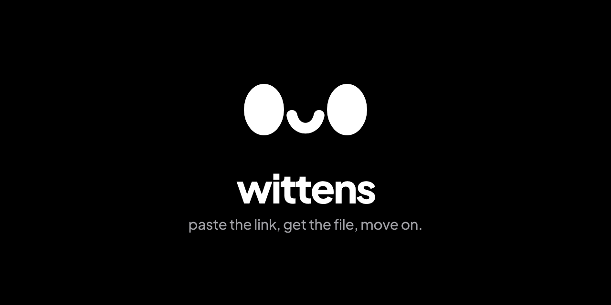
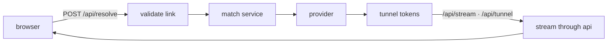

<div align="center">
  

  <p><strong>paste the link, get the file, move on.</strong></p>

  <p>
    A small, fast, open source TikTok downloader.<br />
    No watermark. No ads. No accounts. No tracking.
  </p>

  <p>
    <a href="#quick-start">quick start</a> ·
    <a href="docs/architecture.md">how it works</a> ·
    <a href="docs/api.md">api</a> ·
    <a href="CONTRIBUTING.md">contributing</a>
  </p>
</div>

<br />

## what it does

You paste a public TikTok link. wittens shows a preview and gives you the video in HD or SD, or just the audio as MP3.

- **Clean downloads.** Videos without the watermark, when the provider has them.
- **Honest by design.** The browser only talks to the wittens api. Files are streamed through, never stored, and links are never logged.
- **Forgiving input.** Paste a bare link or a whole share message, wittens finds the link. Press `/` anywhere to jump to the input.
- **Accessible and light.** Keyboard friendly, respects reduced motion, one page, no tracking scripts.
- **Self-hostable.** One Docker image, a handful of environment variables.

## quick start

### with docker

```sh
cp docs/examples/docker-compose.example.yml docker-compose.yml
docker compose up -d --build
```

Open <http://localhost:3000>. More in [how to run an instance](docs/run-an-instance.md).

### for development

You need node.js 20.11 or newer and [pnpm](https://pnpm.io) 10.

```sh
pnpm install
pnpm dev        # api on :3000, web on :5173 (proxies /api to the api)
```

Open <http://localhost:5173>.

```sh
pnpm lint       # type-check both packages
pnpm test       # api test suite
pnpm build      # production build of web and api
```

## how it works



1. The api validates that the input really is a TikTok link.
2. A **provider** resolves the post into title, author, stats and media urls.
3. Each media url is hidden behind a short-lived random token. The client never sees an upstream address.
4. Previews (`/api/stream`, seekable) and downloads (`/api/tunnel`) are piped through the api, protected by an SSRF guard, with nothing written to disk.

The full walkthrough, the security model and how to add a provider are in [docs/architecture.md](docs/architecture.md).

## repository layout

```
wittens/
├─ api/        express + typescript: validation, providers, streaming, tests
├─ web/        react 19 + vite + tailwind v4: the single-page app
├─ docs/       architecture, api reference, env variables, running an instance
├─ assets/     logo and banner
├─ Dockerfile  one image: api + built web app
└─ .github/    ci and issue templates
```

## using the api

```sh
curl -s localhost:3000/api/resolve \
  -H 'Content-Type: application/json' \
  -d '{"url":"https://vm.tiktok.com/ZMxxxxxxx/"}'
```

The response contains `video.downloads.hd.url`, `.sd.url` and `.audio.url`. Fetch them from the same host. They expire after 15 minutes. The full reference is in [docs/api.md](docs/api.md).

## configuration

Everything is optional. The ones you will most likely touch:

| variable | default | |
| :-- | :-- | :-- |
| `API_PORT` | `3000` | listen port |
| `TRUST_PROXY` | `0` | set to `1` behind a reverse proxy |
| `RATELIMIT_MAX` | `20` | resolve requests per client per minute |
| `TUNNEL_LIFESPAN` | `900` | seconds a download link stays valid |

All variables: [docs/env-variables.md](docs/env-variables.md).

## limitations

Being upfront about what wittens is not:

- **It depends on a third-party provider.** wittens does not scrape TikTok itself. It resolves links through [TikWM](https://www.tikwm.com)'s public API, isolated in one file so it can be replaced. If that service changes or throttles, resolving fails until the provider is updated. If you run a public instance, check the provider's terms.
- **Public videos only.** Private posts, login walls and DRM are out of scope, and contributions for them will not be merged.
- **Photo slideshows are not supported yet.**
- **One instance.** Download links and rate limits live in memory, so run a single process.

## ethics

wittens makes it easier to save **public** content that you could already watch in a browser. It does not bypass logins, paywalls or DRM, and it does not keep copies of anything. It works like a proxy.

You are responsible for what you download and what you do with it. Respect creators: don't re-upload their work as your own, and honor copyright and the terms of the platforms involved. wittens is an independent project and is not affiliated with, endorsed by, or sponsored by TikTok or ByteDance. "TikTok" is a trademark of its owner.

## contributing

Contributions are welcome. Read [CONTRIBUTING.md](CONTRIBUTING.md) first, it explains what is in scope and how to get a change merged. Found a security problem? See [SECURITY.md](SECURITY.md).

## license

[MIT](LICENSE).

## acknowledgments

- [cobalt](https://github.com/imputnet/cobalt) by imput. wittens' project structure and request flow (validate, match, resolve, tunnel) are inspired by it. No cobalt code or assets are used.
- [TikWM](https://www.tikwm.com) for the upstream resolver.
- [Express](https://expressjs.com), [undici](https://undici.nodejs.org), [express-rate-limit](https://github.com/express-rate-limit/express-rate-limit) and [dotenv](https://github.com/motdotla/dotenv) on the server.
- [React](https://react.dev), [Vite](https://vite.dev), [Tailwind CSS](https://tailwindcss.com), [Lenis](https://lenis.darkroom.engineering), [Lucide](https://lucide.dev) and [Plus Jakarta Sans](https://fonts.google.com/specimen/Plus+Jakarta+Sans) on the client.
