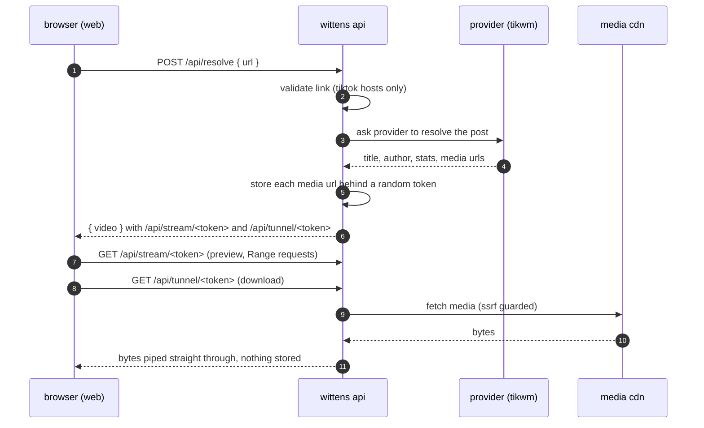

# how wittens works

wittens is a small monorepo with two deployable parts and one rule: **the browser never talks to a third party**. It only talks to the wittens api, which resolves the link, and then streams the file through itself.

```
wittens/
├─ api/   express + typescript. validates links, resolves them, streams files.
├─ web/   react + vite + tailwind. one page: paste, resolve, preview, download.
└─ docs/  you are here.
```

## the request flow



1. **validate.** `processing/url.ts` accepts only `http(s)` links on `tiktok.com` and its subdomains. No credentials, no odd ports, no look-alike hosts such as `tiktok.com.evil.example`. Share messages are fine: the first TikTok link is extracted.
2. **resolve.** `processing/match.ts` picks the provider for the detected service and asks it for the post. Providers live in `processing/providers/` and return a normalized `ProviderResult`.
3. **tunnel.** Every media url the provider returned is stored in an in-memory `TunnelStore` behind a random 144-bit token with a TTL (15 minutes by default). The client only ever receives tokens. It can't point the api at an arbitrary host.
4. **stream.** `stream/proxy.ts` fetches the upstream file and pipes it to the client. `inline` mode (`/api/stream`) supports `Range` so the `<video>` element can seek. `attachment` mode (`/api/tunnel`) forces a download with a clean file name. Nothing is written to disk and nothing is cached.

This is the same shape as [cobalt](https://github.com/imputnet/cobalt): *validate, match a service, resolve, tunnel*. wittens is intentionally much smaller (one service, one provider, no ffmpeg), and it shares no code with cobalt.

## api layers

```
backend/src/
├─ wittens.ts             entrypoint: config, wiring, listen, graceful shutdown
├─ config.ts              typed, validated environment (fails fast on bad values)
├─ core/api.ts            express app: routes, rate limits, headers, errors
├─ processing/
│  ├─ url.ts              link validation + service detection
│  ├─ match.ts            link -> provider -> tunnels -> public response
│  ├─ providers/tikwm.ts  the only place that knows about tikwm
│  ├─ errors.ts           ApiError + stable error codes
│  ├─ filename.ts         safe file names
│  └─ types.ts            Provider interface and the public response type
├─ stream/
│  ├─ store.ts            token -> upstream url, TTL + size cap
│  ├─ proxy.ts            piping, ranges, headers, abort on disconnect
│  └─ fetcher.ts          ssrf-guarded fetch for media
├─ security/guard.ts      private-address blocking
└─ misc/                  logger, version
```

Rules the layers follow:

- `core/` knows HTTP. `processing/` knows nothing about HTTP. `stream/` knows how to move bytes.
- Everything is injected into `createApp()`, so tests run the real app against fakes with no network.
- Expected failures are `ApiError`s with a stable `error.*` code. Anything else becomes a generic 500 and the details stay in the server log.

## security model

| threat | what wittens does |
| :-- | :-- |
| user supplies a malicious link | strict host validation, 2048 char cap, credentials and ports rejected |
| provider (or its cdn) returns an internal address | **ssrf guard**: only http(s) on ports 80/443, IP literals and `localhost` rejected, every resolved address checked at connect time (also stops DNS rebinding), redirects followed manually and re-validated, max 3 hops |
| upstream serves html or scripts as "video" | the response `Content-Type` is always the one wittens chose (`video/mp4`, `audio/mpeg`, `image/jpeg`), plus `nosniff` |
| header injection through file names | file names are reduced to `[a-zA-Z0-9_-]` and capped |
| abuse / scraping | per-client rate limits on resolve and on streams |
| stuck or abandoned downloads | header timeout, idle-body timeout, upstream aborted when the client disconnects |
| tracking | no cookies, no analytics, links and media urls are never logged |
| xss / clickjacking | strict `Content-Security-Policy`, `X-Frame-Options: DENY`, `Referrer-Policy: no-referrer` |

## limits you should know about

- **The provider is a third party.** wittens does not scrape TikTok. It asks [TikWM](https://www.tikwm.com)'s public API. If TikWM changes, throttles or disappears, resolving breaks until a provider is fixed or replaced. Free usage can be throttled, which surfaces as `error.provider.rate_limited` (wittens detects an HTTP 429 or an upstream message that mentions a limit). If you run a public instance, read the provider's terms and consider your own provider.
- **Single process.** Tunnels and rate-limit counters live in memory. Run one instance, or put a shared store behind `TunnelStore` before scaling out. Restarting the api invalidates open download links.
- **Public videos only.** Private posts, DRM and anything behind a login are out of scope.
- **Photo slideshows are not supported yet.**

## adding or replacing a provider

A provider is an object with a `name` and a `resolve(url, signal)` method that returns a `ProviderResult` or throws an `ApiError`.

1. Create `backend/src/processing/providers/<name>.ts`. Keep every upstream-specific field name in that file.
2. Add a test next to `backend/test/tikwm.test.ts` using a fake `Fetcher`. Cover success, "not found", rate limiting, timeouts and malformed responses.
3. Wire it in `backend/src/wittens.ts`.

Adding another **service** (not just another provider) also means extending `Service` and the host check in `processing/url.ts`, and registering a provider for it in `core/api.ts`. Read [CONTRIBUTING.md](../CONTRIBUTING.md) for what is in scope first.
